# Hand-drawn website illustrations

The hand-drawn series is now connected to the actual site: eight covers in `docs/articles/index.md` and three scenes in `docs/index.md`.

- [Open the complete gallery](hand-drawn-gallery.html)
- [Current style specification](hand-drawn-spec.md)
- [Exact prompts and production output paths](hand-drawn-series-prompts.json)
- [Production file validation](hand-drawn-series-validation.json)

The approved specialists pilot is reused for its article. Ten new images were generated individually with the built-in image generator, using that pilot as a style reference. The website uses the versioned `-hand-drawn.png` public assets below; the older geometric preview set is retained in [the previous gallery](preview.html).

## Interaction Closure: What Business Voice AI Needs

Article cover

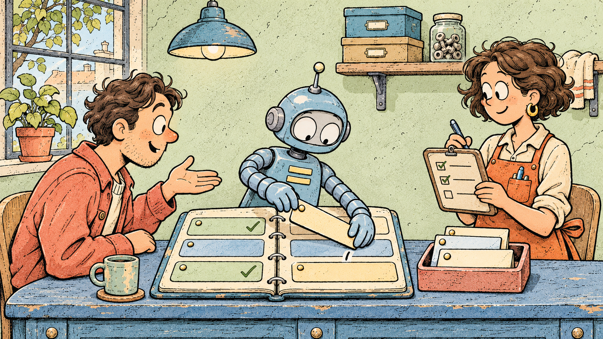

[Full-size PNG](../../docs/public/images/blog/banner/interaction-closure-hand-drawn.png)

## You don’t need an omnipotent AI agent

Article cover

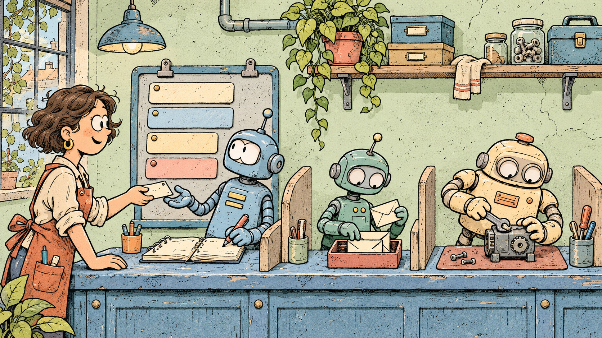

[Full-size PNG](../../docs/public/images/blog/banner/ai-specialists-hand-drawn.png)

## Prompt Engineering will never be fully deterministic

Article cover

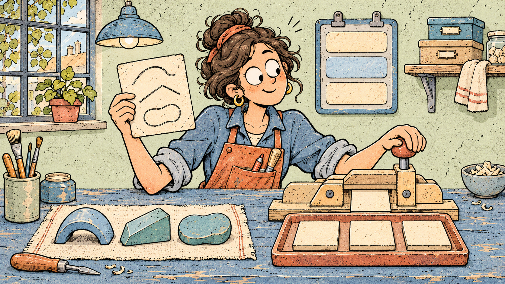

[Full-size PNG](../../docs/public/images/blog/banner/prompt-hand-drawn.png)

## Table reservation CUI design

Article cover

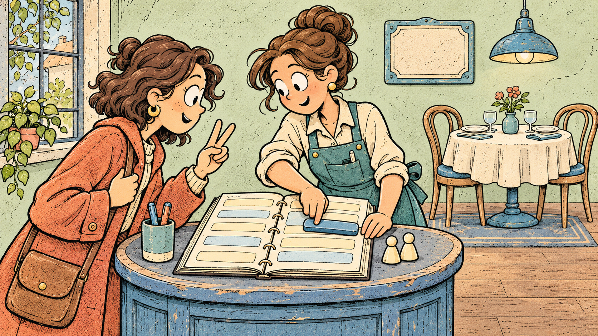

[Full-size PNG](../../docs/public/images/blog/banner/reservation-cui-hand-drawn.png)

## Reuse reservation module to build chatbot

Article cover

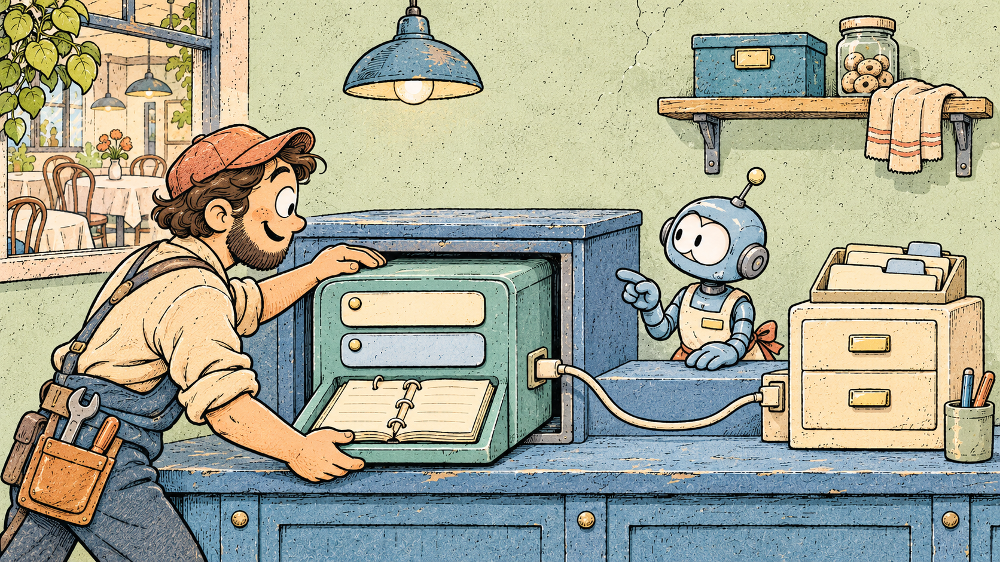

[Full-size PNG](../../docs/public/images/blog/banner/reuse-reservation-module-hand-drawn.png)

## Build a reservation module

Article cover

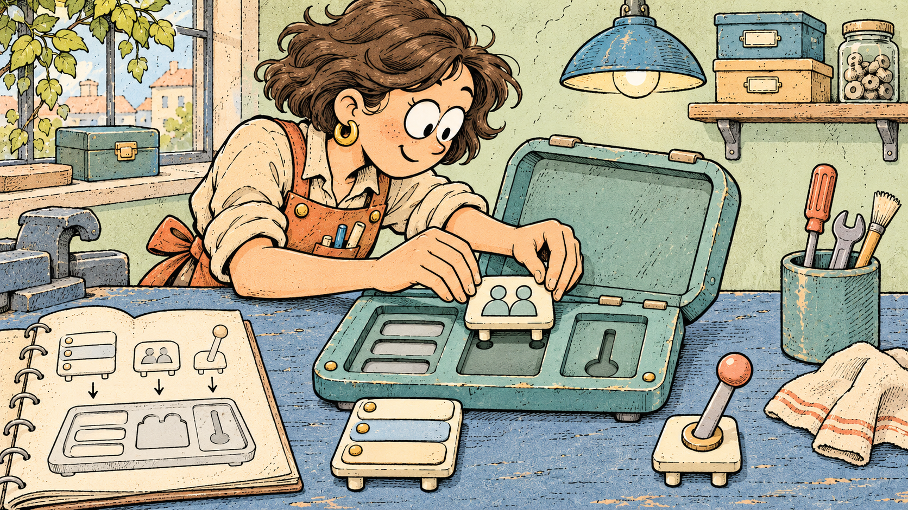

[Full-size PNG](../../docs/public/images/blog/banner/build-reservation-module-hand-drawn.png)

## From schema to snippets: a blueprint for chatbot

Article cover

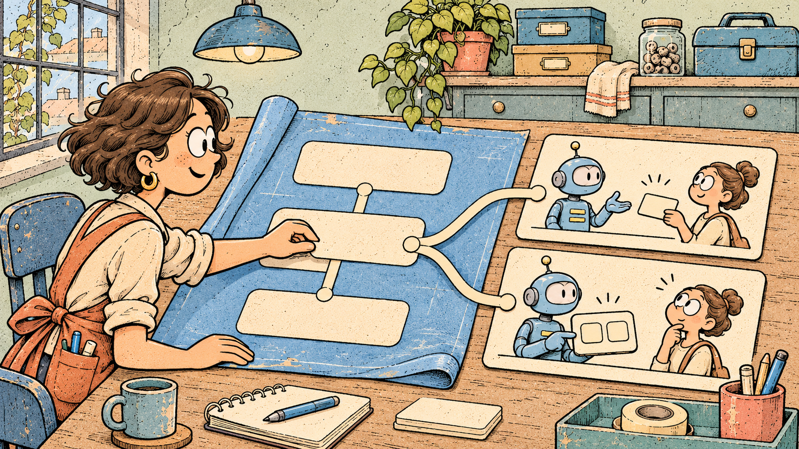

[Full-size PNG](../../docs/public/images/blog/banner/schema-to-snippets-hand-drawn.png)

## Chatbot development with OpenCUI

Article cover

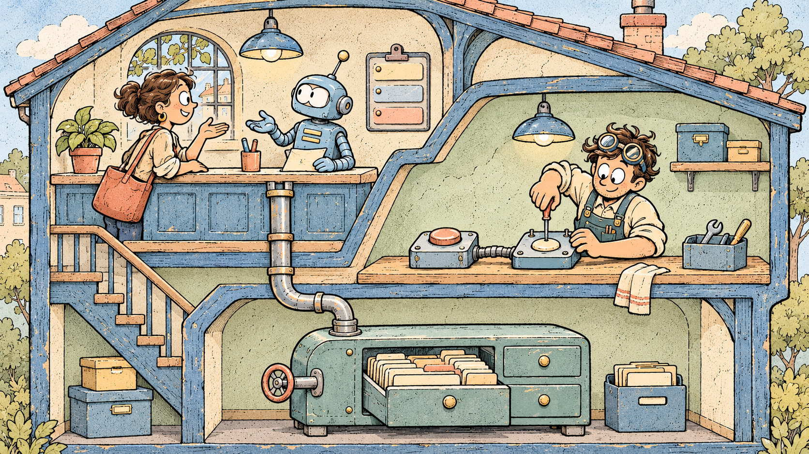

[Full-size PNG](../../docs/public/images/blog/banner/chatbot-development-hand-drawn.png)

## Customize AI Specialists

Homepage illustration

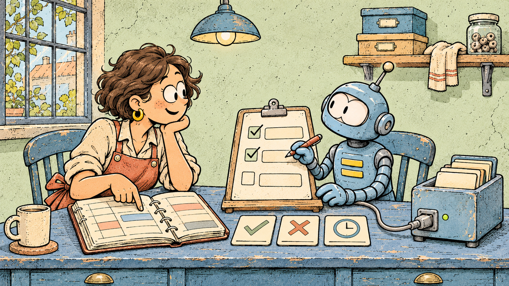

[Full-size PNG](../../docs/public/images/home/customize-specialist-hand-drawn.png)

## Configure Coordinator

Homepage illustration

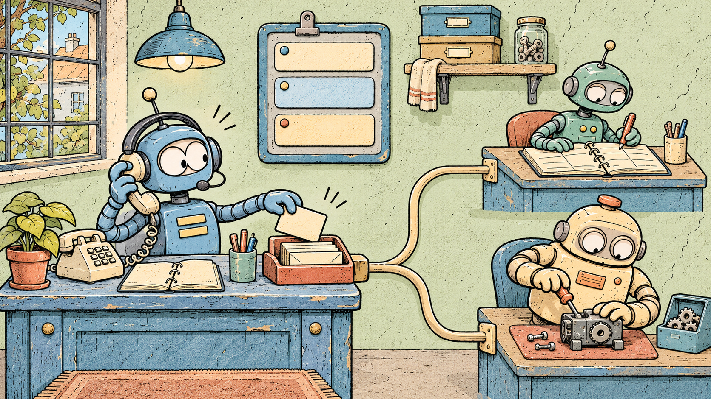

[Full-size PNG](../../docs/public/images/home/configure-coordinator-hand-drawn.png)

## Deploy and Operate

Homepage illustration

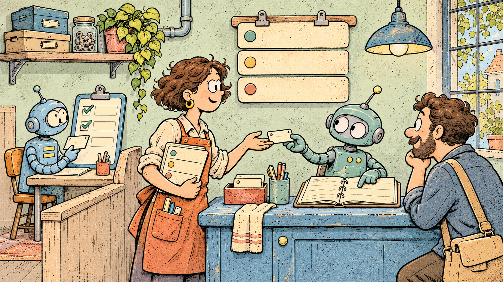

[Full-size PNG](../../docs/public/images/home/deploy-operate-hand-drawn.png)
