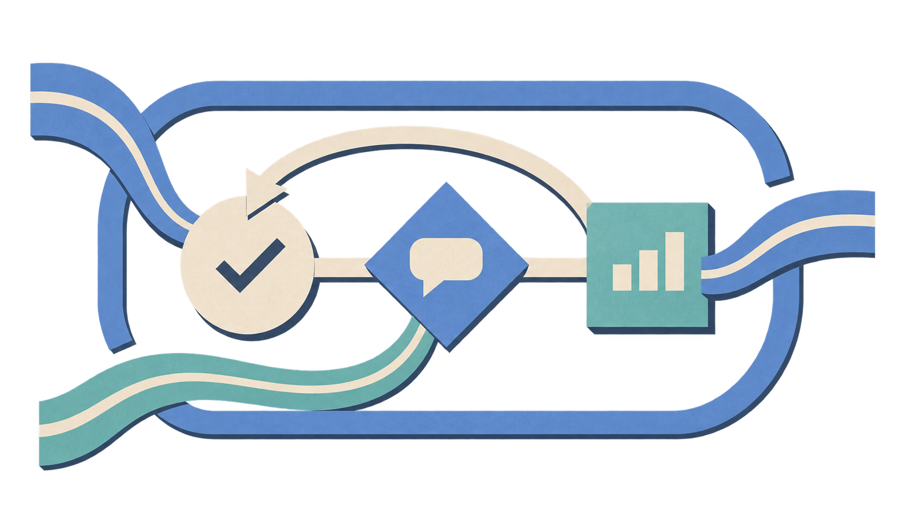
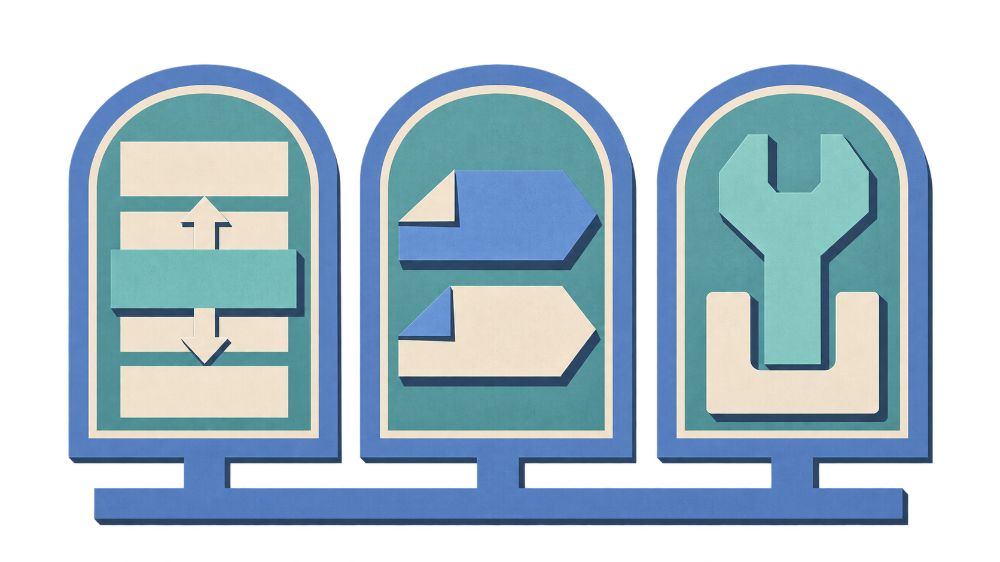
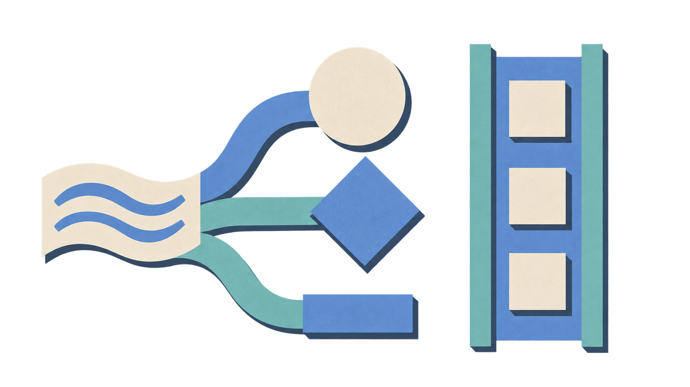
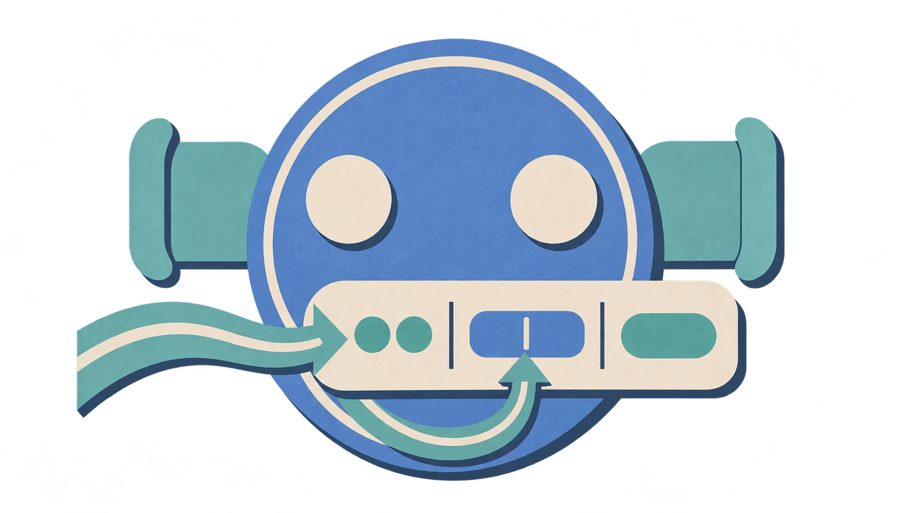
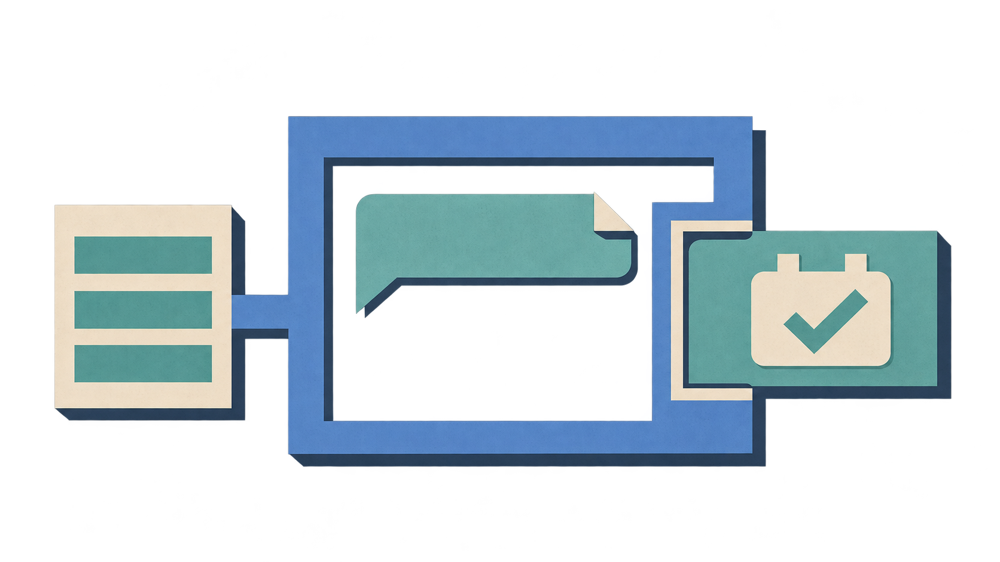
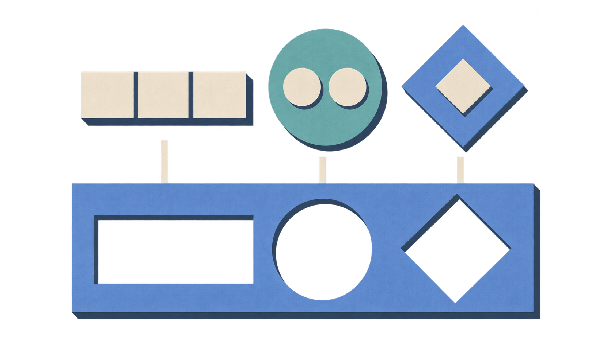
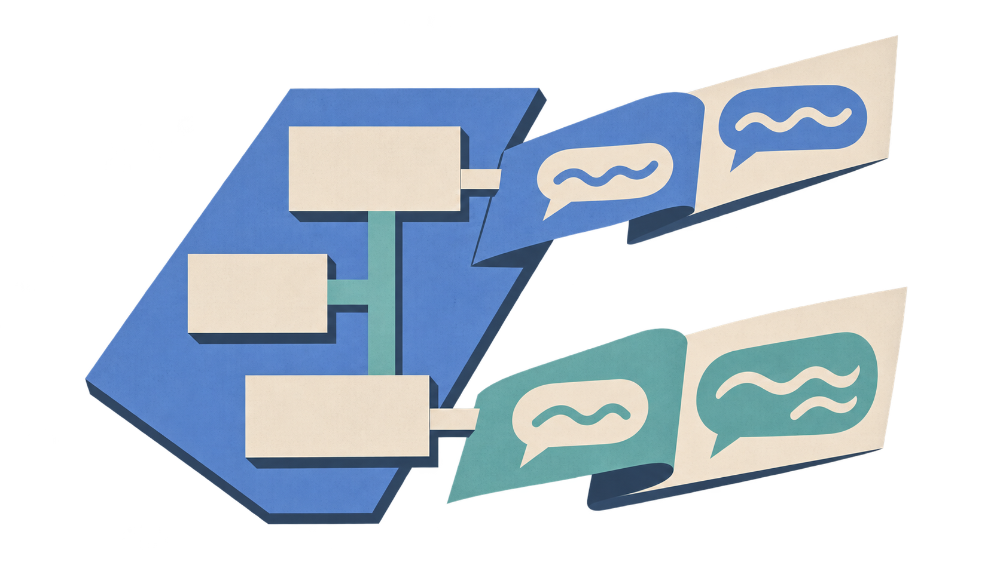
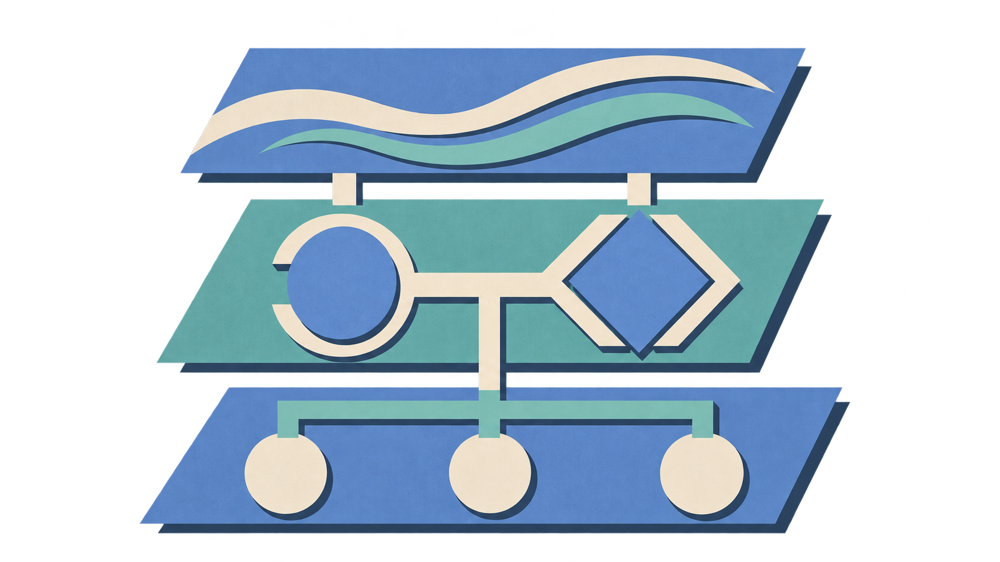

# Blog illustration preview

Eight new cover candidates in the agreed editorial engineering style. The website's current covers are unchanged.

Open [the interactive gallery](preview.html) locally for light/dark surfaces, actual 256 x 160 thumbnails, and full-size views. The images below can also be reviewed directly on GitHub.

- [Style specification](spec.md)
- [Exact prompts, style reference, and output mapping](prompts.json)
- [Image validation](validation.json)

Generated with the built-in image generator, one cover per call, using [the selected pilot](samples/interaction-closure-v2.png) as a style reference.

## 1. Interaction Closure: What Business Voice AI Needs

Conversational paths, governed states, and a return loop for corrections.

[Full-size PNG](candidates/interaction-closure-v3.png) · [Current website cover](../../docs/public/images/blog/banner/interaction-closure.png)

## 2. You don't need an omnipotent AI agent

Three bounded responsibilities coordinated through a shared base.

[Full-size PNG](candidates/ai-specialists-v2.png) · [Current website cover](../../docs/public/images/blog/banner/ai-specialist-vs-omnipotent-agent.png)

## 3. Prompt Engineering will never be fully deterministic

Variable interpretation contrasted with a constrained, repeatable track.

[Full-size PNG](candidates/prompt-determinism-v2.png) · [Current website cover](../../docs/public/images/blog/banner/prompt.png)

## 4. Table reservation CUI design

A top-down restaurant table paired with a revisable reservation strip.

[Full-size PNG](candidates/reservation-cui-v2.png) · [Current website cover](../../docs/public/images/blog/banner/tutorial_reservation_cui.png)

## 5. Reuse reservation module to build chatbot

A finished reservation capability inserted into an application.

[Full-size PNG](candidates/reuse-reservation-module-v2.png) · [Current website cover](../../docs/public/images/blog/banner/tutorial_reservation_chatbot.png)

## 6. Build a reservation module

Separate typed components aligned with their matching slots.

[Full-size PNG](candidates/build-reservation-module-v2.png) · [Current website cover](../../docs/public/images/blog/banner/tutorial_reservation_module.png)

## 7. From schema to snippets: a blueprint for chatbot

A structured schema feeding contextual conversation examples.

[Full-size PNG](candidates/schema-to-snippets-v2.png) · [Current website cover](../../docs/public/images/blog/banner/from-schema-to-snippets.png)

## 8. Chatbot development with OpenCUI

Language, interaction, and service layers composed into one application.

[Full-size PNG](candidates/chatbot-development-v2.png) · [Current website cover](../../docs/public/images/blog/banner/chatbot_development_with_opencui.png)
